<picture><source media="(prefers-color-scheme: dark)" srcset="https://raw.githubusercontent.com/David-Trinh-05/David-Trinh-05/main/assets/hero-dark.svg?v=5"></picture>

<samp>
<a href="mailto:phatsuper14785@gmail.com">phatsuper14785@gmail.com</a> · RAI Lab, HCMUTE · Ho Chi Minh City · <b>open to robotics internships</b>
</samp>

### <samp>01 · SELECTED MISSIONS</samp>

<a href="https://github.com/David-Trinh-05/perchpilot"><picture><source media="(prefers-color-scheme: dark)" srcset="https://raw.githubusercontent.com/David-Trinh-05/David-Trinh-05/main/assets/perchpilot-dark.svg?v=5"></picture></a>

<a href="https://github.com/David-Trinh-05/QDrone_Control"><picture><source media="(prefers-color-scheme: dark)" srcset="https://raw.githubusercontent.com/David-Trinh-05/David-Trinh-05/main/assets/qdrone-dark.svg?v=5"></picture></a>

<a href="https://github.com/David-Trinh-05/aisleops-amr"><picture><source media="(prefers-color-scheme: dark)" srcset="https://raw.githubusercontent.com/David-Trinh-05/David-Trinh-05/main/assets/aisleops-dark.svg?v=5"></picture></a>

<a href="https://github.com/David-Trinh-05/swarm-dashboard-cbf-rl"><picture><source media="(prefers-color-scheme: dark)" srcset="https://raw.githubusercontent.com/David-Trinh-05/David-Trinh-05/main/assets/swarm-dark.svg?v=5"></picture></a>

<a href="https://github.com/David-Trinh-05/iot-edge-gateway"><picture><source media="(prefers-color-scheme: dark)" srcset="https://raw.githubusercontent.com/David-Trinh-05/David-Trinh-05/main/assets/gateway-dark.svg?v=5"></picture></a>

<samp>+ smaller Rust tools</samp>

| Repo | What it proves |
|---|---|
| [mini-kv-store](https://github.com/David-Trinh-05/mini-kv-store) | Checksummed write-ahead log; survives SIGKILL mid-batch, compacts 20 KB of log to 148 B |
| [telemetry-ingest](https://github.com/David-Trinh-05/telemetry-ingest) | HTTP 503 under backpressure; drains all 2,112 admitted records in order on SIGTERM |
| [telemetry-frame](https://github.com/David-Trinh-05/telemetry-frame) | `no_std`, zero-dependency UART framing + CRC-16; builds for `thumbv6m-none-eabi` |
| [button-debounce](https://github.com/David-Trinh-05/button-debounce) | Non-blocking GPIO debounce state machine for bare-metal |
| [http-pulse](https://github.com/David-Trinh-05/http-pulse) | Bounded concurrent HTTP health checks for deploy pipelines |
| [telemetry-replay](https://github.com/David-Trinh-05/telemetry-replay) | Replays timestamped sensor logs at adjustable speed |

### <samp>02 · SYSTEMS MAP</samp>

<picture><source media="(prefers-color-scheme: dark)" srcset="https://raw.githubusercontent.com/David-Trinh-05/David-Trinh-05/main/assets/systems-dark.svg?v=5"></picture>

### <samp>03 · TECH STACK</samp>

<picture><source media="(prefers-color-scheme: dark)" srcset="https://raw.githubusercontent.com/David-Trinh-05/David-Trinh-05/main/assets/stack-dark.svg?v=5"></picture>

### <samp>04 · OPERATING PRINCIPLES</samp>

<picture><source media="(prefers-color-scheme: dark)" srcset="https://raw.githubusercontent.com/David-Trinh-05/David-Trinh-05/main/assets/principles-dark.svg?v=5"></picture>

### <samp>05 · FLIGHT LOG</samp>

<picture><source media="(prefers-color-scheme: dark)" srcset="https://raw.githubusercontent.com/David-Trinh-05/David-Trinh-05/main/assets/flight-log-dark.svg?v=5"></picture>

<samp>simulate it · verify it · then fly it</samp>

