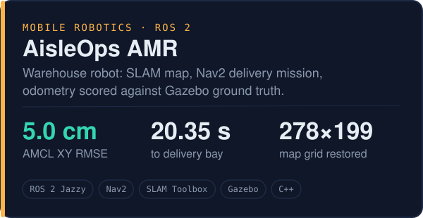

  
  
  

I build **robots**, from warehouse AMRs to quadrotors, in simulation first, then the low-level software that has to run on them reliably. Most of my projects ship with a **reproducible check and a number**: an RMSE against ground truth, a latency percentile, or a crash-recovery test.

## `$ whoami`

## 🧭 Engineering focus

## 🛠️ Tech stack

| Area | Tools |
|---|---|
| **Robotics & autonomy** | ROS 2 Jazzy, Nav2, SLAM Toolbox, Gazebo Harmonic, PX4 (SITL, MAVLink), PyTorch, PPO, Kalman / EKF |
| **Systems** | Rust (`no_std`, Tokio, Axum), C++, Python, FastAPI, MQTT |
| **Embedded / IoT** | UART framing & CRC, GPIO state machines, ESP32 + WebSocket |
| **Also** | MATLAB (quadrotor control), TypeScript / React, Linux, Git |

## 🚀 Selected work

<table>
<tr>
<td width="50%"></td>
<td width="50%"></td>
</tr>
<tr>
<td width="50%"></td>
<td width="50%"></td>
</tr>
</table>

<b>Smaller Rust tools</b>: telemetry, embedded, CLI

| Repo | What it proves |
|---|---|
| [telemetry-ingest](https://github.com/David-Trinh-05/telemetry-ingest) | Returns HTTP 503 under backpressure; on SIGTERM drains all 2,112 admitted records in order |
| [telemetry-frame](https://github.com/David-Trinh-05/telemetry-frame) | `no_std`, zero-dependency UART framing + CRC-16; builds for `thumbv6m-none-eabi` |
| [button-debounce](https://github.com/David-Trinh-05/button-debounce) | Non-blocking GPIO debounce state machine for bare-metal |
| [http-pulse](https://github.com/David-Trinh-05/http-pulse) | Bounded concurrent HTTP health checks for deploy pipelines |
| [telemetry-replay](https://github.com/David-Trinh-05/telemetry-replay) | Replays timestamped sensor logs at adjustable speed |

## 📐 How I work

| | Principle | Where you can see it |
|---|---|---|
| 🛑 | **Gate before you actuate.** Nothing powers down or takes control until a check passes. | PerchPilot verifies attachment before motors-off · Swarm keeps OFFBOARD inactive behind readiness gates |
| 📏 | **Measure against ground truth.** A demo without a number is a video. | AisleOps scores AMCL at 5.0 cm RMSE against Gazebo pose |
| 💥 | **Assume the crash.** Kill it mid-write and check what survives. | mini-kv-store SIGKILL recovery · telemetry-ingest ordered drain on SIGTERM |
| 🔁 | **Port it and prove parity.** | PerchPilot's Python policy node rewritten in Rust: output parity ≤ 5e-6 |

## 📓 Flight log

- [x] Rewrote PerchPilot's onboard node in Rust (`r2r`), matching the Python node to 5e-6
- [x] Replaced learned depth in the swarm follow-target with bearing-only multi-view EKF
- [x] Nav2 delivery mission on a saved SLAM map, scored against Gazebo ground truth
- [ ] Move from SITL to hardware-in-the-loop for the perching stack
- [ ] Run `telemetry-frame` on a real MCU over UART

